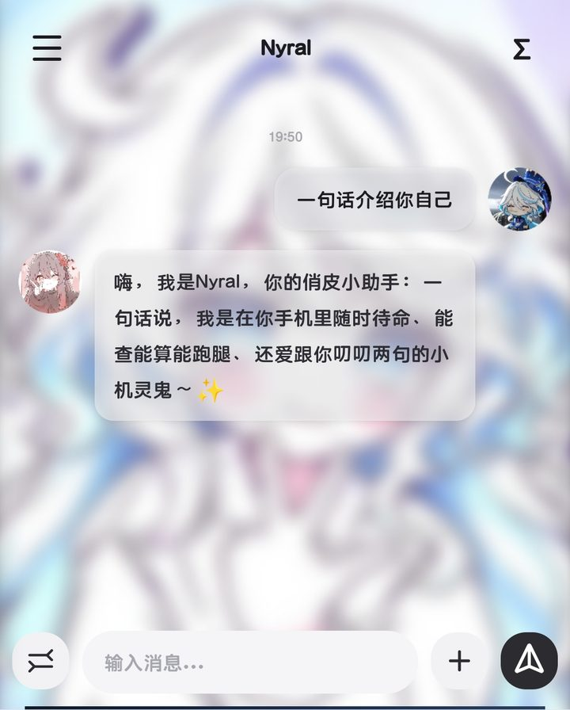
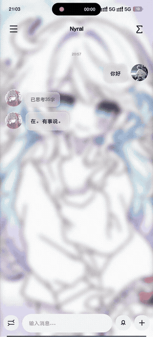

---
AIGC:
    Label: "1"
    ContentProducer: 001191440300708461136T1XGW3
    ProduceID: dde0bd45bc80f76ab27dc0d7783eab7c_3e18870fd39a11f19fe5525400638852
    ReservedCode1: yiznI6slvFUlNrXnKAFQWPXeqbPaQhFYVjL7WJAYOWv43xpzZdTnz3kIpfJHaERasKaD1MSI5iKCD/h1SH3uY7WH6QufYQzdRQb44APlFTk6syC47+PZDF/8S5qgF5dI69LHwvILBGdUQocvA5nrc0/vOG4nvlK1RUwM2x7QhM4OJqoDg4C/xBz7t6k=
    ContentPropagator: 001191440300708461136T1XGW3
    PropagateID: dde0bd45bc80f76ab27dc0d7783eab7c_3e18870fd39a11f19fe5525400638852
    ReservedCode2: yiznI6slvFUlNrXnKAFQWPXeqbPaQhFYVjL7WJAYOWv43xpzZdTnz3kIpfJHaERasKaD1MSI5iKCD/h1SH3uY7WH6QufYQzdRQb44APlFTk6syC47+PZDF/8S5qgF5dI69LHwvILBGdUQocvA5nrc0/vOG4nvlK1RUwM2x7QhM4OJqoDg4C/xBz7t6k=
---


<div align="center">

<picture>
  <source media="(prefers-color-scheme: dark)" srcset="docs/logo.png">
  
</picture>

# Nyral

### An open-source personal agent that lives on your Android phone

**Chat · on-device long-term memory · SSH remote ops · an agent that drives its own browser**

[English](README.md) | [中文](README.zh-CN.md)


[**Download APK**](../../releases/latest) ｜ [APKPure](https://apkpure.com/p/io.github.aixtin.nyral) ｜ [Website](https://atin.asia/nyral/) ｜ [Quick start](#quick-start) ｜ [What it does](#what-it-does) ｜ [Project status](#project-status)

> **Official downloads only:** the APK is published on the [GitHub Releases](../../releases/latest) and [Gitee Releases](https://gitee.com/aixtin/Nyral/releases) pages, and on [APKPure](https://apkpure.com/p/io.github.aixtin.nyral), where the developer uploads the build directly (official mirror). Packages on any other third-party mirror site are not built or verified by us — please download only from these channels. Project home page: [atin.asia/nyral](https://atin.asia/nyral/).

</div>

<p align="center"></p>

<p align="center">
  
  &nbsp;&nbsp;&nbsp;&nbsp;
  
</p>

<p align="center"><sub>Left: chat &amp; tool calls &nbsp;|&nbsp; Right: sidebar — sessions, tasks and safe mode in one place</sub></p>


---

> **One thing to get out of the way: local-first does **not** mean on-device model.**
> Nyral does not run a multi-GB LLM on your phone. Chats, memory and files stay in a local SQLite database; inference goes to the API key you provide (any OpenAI-compatible endpoint, cloud or self-hosted). No account, no telemetry.

## What it does

| Capability | Details |
| --- | --- |
| **On-device long-term memory** | bge-small ONNX embeddings + keyword recall over SQLite; remembers across sessions, text never leaves the phone |
| **32 built-in tools** | Web search/fetch, SSH with jump hosts, local shell, in-house Agent browser, accessibility control of third-party apps, on-demand PDF/image/audio/video reading, scheduled jobs, AI image generation |
| **Built-in agent browser** | The agent opens pages, clicks, fills forms and reads them; captchas are handed back to you in one tap |
| **Any model, your key** | MiMo / DeepSeek / GLM / any OpenAI-compatible endpoint, switchable per chat |

## Quick Start

1. Install the APK, open Settings → Model Config, and enter the **Base URL + API Key** of any OpenAI-compatible endpoint (without this it cannot chat)
2. (Optional) Add remote hosts in SSH Config: password or private key (ED25519 supported via the built-in BC), proxy jumps supported
3. Start chatting; the AI calls tools on demand, with tool-call progress shown collapsed inside bubbles
4. Long-term memory archives automatically; saying "remember xxx" archives immediately

---

## In-depth Articles

Real-world engineering notes on keeping a personal agent alive on Android (background keep-alive, scheduled jobs, Live Updates / Dynamic Island):

- Juejin: [How a Personal Agent Survives on Android: Background Keep-alive, Scheduled Jobs and Live Updates](https://juejin.cn/post/7702914241569472547)
- Zhihu: [移动智能体的安卓生存法则：厂商收权时代下个人 Agent 的后台保活、定时岗位与灵动岛实战](https://zhuanlan.zhihu.com/p/2100298508075062070)
- Bilibili: [移动智能体的安卓生存法则：厂商收权时代下个人 Agent 的后台保活、定时岗位与灵动岛实战](https://www.bilibili.com/opus/1265696668531032098)

---


## Overview

Nyral is an open-source personal agent for Android: LLM chat, long-term local memory, SSH remote operations, web tools, and voice/attachment multimodality in a single app. Data stays on your device by default — no account, no behavioral tracking, no analytics or ad SDKs; model and tools are fully under your control, bring your own API key or self-host an endpoint.

> Privacy-first · BYO model · Open source · No root · No account

## Key Features

**Chat & Models**
- Multi-provider on-demand switching: MiMo full-modal / DeepSeek / GLM / any OpenAI-compatible endpoint; custom models with per-model capability toggles
- Streaming output: typewriter-style thinking segments + streaming Markdown body rendering (Markwon); thinking and tool-call sections collapsible
- In-message Markdown table rendering (Scheme C): independent block-level TableView inside bubbles, live layout during streaming, vertically centered cells, consistent across chat and agent modes
- Thinking intensity tiers: auto / on-off / low-mid-high shown per provider capability; unsupported tiers hidden
- Voice input: press-and-hold to speak, swipe-up to cancel, 60-second cap with auto-send; WeChat-style voice bubbles (PCM via AudioRecord, WAV-wrapped, compatible with mainstream multimodal APIs)

**Attachments & Multimodality (v19+)**
- Images: compressed locally (max 2048px long edge) then sent via `image_url`
- Videos: transcoded locally when >37MB, first-frame thumbnail embedded in bubble
- Documents (PDF/txt/md/docx/xlsx...): parsed locally, text injected straight into context without burning vision tokens; scanned PDFs auto-rendered to page images for the vision channel
- Up to 6 attachments per message; in-app fullscreen preview (image zoom / video play / PDF paging / text copy)

**Long-term Memory (on-device)**
- bge-small ONNX on-device semantic vectors + keyword LIKE dual-path retrieval, SQLite storage
- Rolling memory: short-term rolling window + single-slot rolling summary (overwritten via `INSERT OR REPLACE id=1`, compressed by auxiliary model) + long-term full text with semantic search
- Retrieval decision is made per-turn by the auxiliary model over the network (blocks each turn; on failure it silently skips retrieval)
- Optional separate "auxiliary AI" for memory indexing without consuming the main chat model
- Pending queue persisted + atomic consumption transactions: no lost or duplicated messages after process kill

**Tool Calling (40-round cap, 32 built-in tools across 13 capability groups)**

<details>
<summary><b>Tool list</b> (click to expand · 32 built-in tools)</summary>

- Network (4): `web_search` (four-engine rotation: Sogou mobile → Bing RSS → Bing web → Baidu; direct access in mainland China, no key) / `web_fetch` / `web_download` / `site_auth` (per-domain cookie auto-injection)
- SSH (3): `ssh_run` / `ssh_config_add` (add or edit jump-host connections, usable immediately) / `file` (remote list/read/info/write/upload/download, ProxyJump over JSch, ED25519, dual auth)
- Execution (2): `js_run` (sandboxed JS with ClassShutter class restrictions) / `sh_run` (local shell with dangerous-command interception + root elevation)
- Device (4): `app` (accessibility-driven control of third-party apps) / `device_snapshot` (live CPU / RAM / SoC temp / battery / disk panel) / `device_probe` (read-only probe of one package or process) / `write_clipboard` (write text to the system clipboard)
- Files (1): `workdir` (local workdir `Download/Nyral_work`: list/read/write/grep/head/stats; the AI pulls files locally, edits, and pushes them back — avoids SSH quoting hell)
- Attachments (7): `attach_read` (chunked read of text / docx / xlsx / pptx / archives) / `pdf_page` (read a PDF page by page as image or text) / `image_view` / `audio_read` / `video_frame` (frame sampling) / `file_export` (export to the public workdir) / `read_file_audit` (attachment deletion audit log)
- Memory & utils (3): `memory_search` (semantic local search) / `get_time` / `calc` (Rhino interpreter)
- Security (1): `security_set` (SSH host-key trust; the danger gate and root auto-grant stay user-only via Settings → Security Center)
- Browser (1): `browser` (in-house agent-browser: open / scan / text / scroll / click / type / upload, cookie cache, `save_cookies` into site_auth, one-tap CAPTCHA handoff to the user)
- Delivery (2): `artifact_save` (text artifacts as cards) / `artifact_save_bin` (base64 binary artifacts)
- Media (1): `gen_image` (AI image generation, provider-driven, monthly quota gated)
- Meta (2): `ask_user` (interactive clarification) / `tool_detail` (tool documentation)
- Scheduling (1): `timer_task_create` (scheduled-job station: goal analysis, per-item dangerous-tool authorization with reasons, one-shot approval, task-scoped capability pre-authorization)

</details>


**MCP (Model Context Protocol)**
- Client: connect any Streamable HTTP MCP server (protocol `2025-06-18`, `Authorization: Bearer`); 4 presets (DeepWiki / Context7 / Microsoft Learn / GitHub), test-before-save, delete with confirmation
- Token-friendly: top 4 tools stay resident, the rest are indexed and pulled in on demand via the built-in `tool_detail`
- Server: Nyral itself is a read-only MCP server (`/mcp` on the debug port) exposing `phone_status` / `phone_memory_search` / `phone_screen`, so a desktop agent can query the phone
- Loopback / LAN only, token-authenticated, no cloud relay — see [docs/MCP.md](docs/MCP.md)

**Security**
- Secondary confirmation for dangerous operations: confirm-then-execute; same params exempted for 5 minutes; rejection stops immediately with a receipt; timeout auto-rejects; full audit trail (allow/deny/timeout) persisted
- SSRF protection (redirect-target validation for web_fetch/web_download) + log redaction (non-2xx API response bodies and SSH private-key contents never logged in plaintext)
- Sandboxed execution (js_run ClassShutter) + dangerous-command interception (sh_run) + SSH host-key verification (unknown hosts rejected)

**UI**
- Multi-session management (pin/delete/search), full-text session search (body + thinking, relevance-ranked)
- Token usage stats (main AI / auxiliary AI dual channels; cumulative / daily / per-session)
- Runtime logs (main + memory archive), foreground-service keep-alive notification
- Chat backgrounds (preset gradients / custom image blur), global animation system (bubble entrance / popup jelly expansion / press-scale)

## Requirements

- Android 10+ (minSdk 29)
- arm64-v8a
- At least one OpenAI-compatible API endpoint (self-hosted or cloud)

## Build

```bash
git clone https://github.com/aixtin/nyral.git
# repo root is the project root; no cd needed
./gradlew assembleDebug
# Output: app/build/outputs/apk/debug/app-debug.apk
```

Requires JDK 17, Gradle 8.13, Android SDK 36. The repo ships `gradlew` (pinned to Gradle 8.13); a system Gradle 8.13 works too. `settings.gradle.kts` includes Aliyun mirror config for faster builds in mainland China — remove the `maven(...)` lines if you are elsewhere.

> Release-signed builds: `./gradlew assembleRelease` (self-managed keystore read from `keystore.properties`; both keystore and properties are gitignored — prepare your own keys).

## Directory Layout

<details>
<summary><b>Expand full directory layout</b></summary>

```
android-agent-app/
├── app/src/main/java/io/github/aixtin/nyral/   # Main package: entry + session/rendering core
│   ├── MainActivity.kt          # Chat main UI (~4470 lines, post domain-split)
│   ├── ChatSessionState.kt      # Session state machine (streaming field consolidation)
│   ├── ChatFlowController.kt    # Send / streaming callback control
│   ├── StreamUiBridge.kt        # Streaming row creation + LocalEngine callback bridge
│   ├── MdTableView.kt / MdBlocksView.kt / MdBlocksRender.kt  # In-message table rendering (Scheme C)
│   └── RoundedTablePlugin.java / RoundedTableRowSpan.java / RoundedCodeBlockSpan.java  # Markwon table plugins
└── app/src/main/java/io/github/aixtin/nyral/all/   # Feature modules (98 Kotlin files)
    ├── LocalEngine.kt           # Engine: tool registry + dispatch + dialog loop (~1650 lines)
    ├── MainActivityVoice.kt / MainActivitySession.kt / MainActivityInputBar.kt  # MainActivity domain splits
    ├── SecurityConfig.kt / SecurityUi.kt   # Security confirmations (dangerous-op second confirmation)
    ├── MainUi.kt / UiKit.kt / BubbleSpans.kt / Typewriter.kt  # UI building & animations
    ├── ApiConfig.kt / MemoryApiConfig.kt   # Provider & model capability tables
    ├── MemoryDb.kt / MemoryKeeper.kt / MemoryEmbedder.kt / BertTokenizer.kt / MemoryTools.kt  # Memory stack
    ├── SshTools.kt / SshConfigStore.kt / FileTools.kt / WorkDir.kt / WorkTools.kt  # SSH/SFTP/workdir
    ├── WebTools.kt / ScriptEngine.kt / UiControlService.kt  # Web / sandboxed execution / device control
    ├── BrowserPage.kt           # In-house agent browser (full-screen WebView + AI takeover/highlight/CAPTCHA handoff)
    ├── AttachmentStore.kt / DocTextExtractor.kt / PdfTextExtractor.kt / VideoCompressor.kt  # Attachment pipeline
    └── SettingsActivity.kt / ModelEditActivity.kt / McpConfigActivity.kt / ...  # Settings pages
└── app/src/main/assets/mem_model/   # bge-small quantized ONNX model + vocab
```

</details>

## Data & Privacy

- Conversations, memory, token stats, and SSH config (encrypted storage) stay on-device by default; no account system
- No behavioral tracking, no analytics/ad SDKs; the only outbound diagnostic is **anonymous crash reporting** (device model, Android version, crash stack, last 30 runtime log lines — never chat content or PII), on by default and one-tap disable in Appearance Settings → Quick Switches; feedback is uploaded only when you open About → Send Feedback and tap Submit (max 500 chars, same crash channel)
- The only other startup external request is the GitHub Release update check (404 ignorable)
- **Note**: chat messages and attachment contents are sent to the model endpoint you configure (OpenAI-compatible); self-host an endpoint for full privacy
- Permission list and security design (DebugServer protections / dangerous-op gates / data boundaries): see [SECURITY.md](SECURITY.md)

## Roadmap

<details>
<summary><b>Roadmap</b>: <span style="color:#1a7f37"><b>10/11 completed</b></span> (click to expand)</summary>

- [x] Multi-model capability table & custom models
- [x] Local memory (bge semantic retrieval + keyword recall + rolling summary)
- [x] SSH remote filesystem + proxy jumps + SFTP upload/download
- [x] Web tools (four-engine search rotation / fetch / download / site_auth cookie injection)
- [x] Attachment multimodality: images/videos/audio/PDF/Office (v19)
- [x] Voice input loop (record / send / voice bubble, v20)
- [x] Session search + token stats + foreground-service keep-alive
- [x] Workdir batch tools (grep/head/stats, 40-round tool cap)
- [x] Browser module (in-house agent browser: full-screen takeover + AI highlight + CAPTCHA handoff)
- [x] GitHub Release publishing (signed builds since v2.0, in-app update prompt live)
- [ ] Further optimization of conversation context rolling/summary strategy

</details>


## Changelog

- **[Latest] v2.9.22 (2026-11-09, versionCode 135)**: Scheduled-task, streaming and tool-call correctness fixes. Timed jobs no longer die silently: the post-chat 「pending stop」 marker used to survive on the service instance and swallow the next real alarm inside `onStartCommand`, so every scheduled task stopped firing while the UI still showed 「enabled」—alarms now start through a dedicated `startTimerTask()` that clears the marker first, and the marker itself is only honoured within 5 s of being set. Reasoning models no longer lose the first character of every answer: when one SSE frame carried both a `reasoning_content` tail and the beginning of `content`, the parser skipped the text branch and dropped that frame; the two streams are now handled independently. Tool calls leaked into the body as raw XML tags (seen with DeepSeek Flash) are scrubbed on all three paths, and already-polluted history is cleaned up. The one-time 「检测活人」 card after an upgrade is gone (automatic `PULSE` reporting removed) and the suggestion box now lives in Settings → About → Send Feedback, still uploaded as `type: FEEDBACK` only when you tap Submit. About-page links are regrouped into Official / Community & feedback / Legal and now include GitHub, Gitee and the Tencent Channel. Also included: `sh_run` alias, tool-description cross references, `js_console` and repeated-web-call fixes.
- **v2.9.21 (2026-11-08, versionCode 134)**: Chat-mode rendering and bubble-width fixes. Artifact cards in chat mode (avatar layout) are clickable again: the plain-text path used to collapse `[📦 artifact](att://…)` into bare text with no link handler once Markdown was off, so a link-preserving plain-text pipeline was added (sentinel placeholders, links restored in reverse order, `LinkMovementMethod` attached only when links exist and cleared otherwise so recycled views cannot swallow taps) and wired into all four chat-mode text sinks. Long artifact names no longer spill out of the narrower chat bubble: the label budget is now derived from the bubble's real available width (chat mode subtracts the 120 dp avatar column, roughly 18 units on a 360 dp screen) while agent mode keeps the previous 28 units. The chat-mode 「Show Markdown」 toggle is retired — chat mode always renders Markdown now, and its grid slot carries the 「Video direct send」 switch, moved out of Settings (the old temporary row there is gone). Also included: foreground-service timeout crash and Android 10 window-inset crash fixes, a `device` field on feedback pulses, and a visible hint when the config file cannot be read.
- **v2.9.20 (2026-11-08, versionCode 133)**: Liveness-check reliability, plus an honest skip path. This release rolls up the whole liveness-check line (v2.9.11 onward, versionCode 124 to 133), which was never published separately. On devices whose launcher never hands window focus to the activity (seen on some OEM ROMs), the card could stay hidden forever because showing it was gated on `hasWindowFocus`; focus is now retried every 1.5 s and the card is forced up once the retries run out, and the check interval drops from 60 s to 1 s. An upgrade from an older build is no longer mistaken for a fresh install when the stored last-version is missing (an install/update time gap decides instead), and the last-version marker is written only after the card has actually been shown, so a launch race cannot swallow the prompt. Skipping is no longer silent: Cancel and a tap outside the card both send a single `answer: cancel` pulse (Confirm still sends `answer: yes`), so the once-per-version question is recorded either way; the skip control was reworked into a plain unframed 12 sp text button so the primary action stays dominant. Both pulses stay anonymous (version name/code, Android version, timestamp, per-install random ID) and are skipped entirely while crash reporting is switched off.
- **v2.9.11 (2026-11-08, versionCode 124)**: Liveness check & suggestion box — after an upgrade the app asks once per version with a deliberately blunt 「检测活人」card. Confirming sends a single anonymous pulse over the existing crash channel (`type: PULSE`; app version name/code, Android version, timestamp, per-install random ID); Cancel sends nothing and the question is not repeated for that version. Confirming then opens an optional suggestion box (max 500 chars) that uploads only the text you type, and only on Submit (`type: FEEDBACK`). Fresh installs and same-version launches are never interrupted, the card yields to a pending update dialog, and everything is skipped while crash reporting is switched off.
- **v2.9.10 (2026-11-08, versionCode 123)**: Static-analysis cleanup — same user-facing fixes as v2.9.9, with the detekt findings that release introduced (7 → 0) resolved. The error card is now assembled from separate head / message / detail / actions builders instead of one long function, and the error-text mapper became a keyword table rather than a long `when`; wording and behaviour are unchanged.
- **v2.9.9 (2026-11-08, versionCode 122)**: Truncated-reply fix and channel cleanup. If a stream dropped right after a chunk with no trailing newline, the leftover buffer was discarded and the whole turn was misjudged as an empty response; the abort path now folds that residual into the reply first (an incomplete tool-call frame excepted), so a half-received answer stays on screen and the stop path is reused for teardown. Error reporting is two-layered: a short human-readable cause (401/403/404/429/context overflow/timeout/DNS/dropped stream/5xx/400) with the raw payload folded into a details section, and an error card is only kept when the turn genuinely produced nothing. The F-Droid channel is dropped (the platform did not accept the project) — releases continue on GitHub and Gitee only, and both the `IS_FDROID` build flag and the store-skip branch in the update checker are removed.
- **v2.9.8 (2026-11-07, versionCode 121)**: Streaming-path hardening. When an SSE connection dropped mid-call, a half-received tool-call argument string was executed as if complete: the parser read a JSON `null` `finish_reason` back as the string "null", so every frame looked finished. Missing and null fields are now told apart, and a partial tool call from an interrupted stream is discarded with an explicit warning. Tool support no longer stays disabled for the rest of the process either — a single 4xx `tools unsupported` answer used to strip tools from every later turn; the flag is now keyed per provider and model and re-probed after a cooldown. While tool arguments stream in, the waiting row shows progress (`generating xxx · N KB`, throttled at 512 B / 800 ms), and stopping a turn compensates already-complete, idempotent artifact writes instead of losing them. The Markdown block cache gained an LRU cap and collision-resistant keys; a randomized invariant test runs 200k iterations in nightly, and an on-device regression suite (mock SSE provider driven through the debug channel, 7 scenarios / 50 assertions) now lives in `scripts/ui-regression`.
- **v2.9.7 (2026-11-05, versionCode 120)**: Reliability pass on the semantic-model download, plus a smaller APK. The bundled model is gone — the app no longer ships `assets/mem_model`, so the hot-updated copy in `filesDir` is the single source (APK drops from ~58 MB to ~41 MB). The downloader is now built for weak networks: the old one-shot 24-hour backoff is replaced by a ladder (60 s / 5 min / 30 min / 2 h / 24 h), being offline no longer counts as a failure and downloading resumes automatically when the network comes back (new `ACCESS_NETWORK_STATE` permission drives a connectivity callback), switching mirrors keeps partial progress, and the read timeout goes from 30 s to 60 s. Because the Gitee attachment CDN ignores `Range` (verified: 302 to a CDN that answers 200 with the full 24 MB and no `Accept-Ranges`), a 24 MB stream that dies mid-way used to restart from zero — the model is now fetched as six 4 MB parts that land independently and survive process kills, then get concatenated, MD5-checked and atomically swapped in.
- **v2.9.6 (2026-11-05, versionCode 119)**: On a fresh install (or after clearing data) the hot-updated semantic model is now downloaded automatically at cold start - no need to open Settings first. Failed downloads back off for 24 hours and the marker is cleared on success. The downloader is also hardened: it validates the `Content-Range` start offset (a CDN that ignored `Range` used to make a full response be appended to the existing partial file, inflating a 24MB model to 44MB) and caps writes at the manifest-declared length; downloads go to a `.part` file that is truncated precisely, MD5-verified, then atomically swapped in.

<details>
<summary>Older versions (v2.9.5 – v2.8.27, 11 releases)</summary>

- **v2.9.5 (2026-11-05, versionCode 118)**: Follow-up to v2.9.4 — the semantic-model entry in Settings now reports the real state. `ModelUpdater` is initialised at app start (and defensively by the settings screen) instead of only when the model page is opened, so an already-downloaded model is no longer shown as "not ready"; the entry subtitle also refreshes once per second while the screen is visible, so download progress tracks live from the settings list.
- **v2.9.4 (2026-11-05, versionCode 117)**: Semantic model hot-update download fixes. The signature URL is now derived as `manifest.sig` (it used to append `.sig` to `manifest.json`, so both sources returned 404 and every manual download failed); downloaded files now land under the names the embedder actually reads (`bge_model.onnx` / `bge_vocab.txt` instead of the manifest's `model_quantized.onnx` / `vocab.txt`, which previously produced a file the app never loaded); progress is byte-based and reported live during transfer instead of only jumping at completion; the status card polls every 500 ms while visible, so downloading / progress / ready states refresh without leaving the page. Resume hardened: when a server ignores `Range` and answers 200, the partial file is reset instead of having corrupt bytes appended.
- **v2.9.3 (2026-11-05, versionCode 116)**: UI consistency and display fixes: the Diagnostics screen now follows the global UI spec (back icon, title-bar spacing, press feedback, rounded-up half-point font sizes, also applied to first-run setup, guide and browser menu); fixed the artifact viewer's title bar overlapping the system status bar (root layout now consumes system bar insets, bottom action bar adapted for the gesture bar). Added a pre-release sensitive-scan script (scripts/sensitive_scan.sh) with the collaboration-statement exemption on file.
- **v2.9.2 (2026-11-05, versionCode 115)**: New — image generation channel expansion: Zhipu GLM-Image/CogView (open.bigmodel.cn) and Volcano Ark Seedream (ark.cn-beijing.volces.com) with per-provider contracts (sync response, `data[0].url` extraction, provider-correct size formats; Ark now drops the size field entirely since it only accepts tier keywords like 1K/2K/4K, not pixel pairs). Key entry is now strictly manual — the sk- auto-extraction regex from pasted example text was removed so no token can be harvested accidentally. Test button probes at 1024×1024 instead of 512×512. Fixed — the artifact store's 512KB cap could fail generated images or silently force them down to 384×384; gen images now have a dedicated 4MB limit with JPEG step-down compression fallback.
- **v2.9.1 (2026-11-05, versionCode 114)**: New — dual-channel download support (GitHub/Gitee multi-source fallback) and F-Droid channel support; version bump release.
- **v2.9.0 (2026-11-04, versionCode 113)**: New — file management page rework (attachment cards get an AI-artifact purple badge, a dedicated "AI artifacts" tab with type + AI dual grouping, bulk delete with confirm); deletion audit trail (every delete records a pre-delete snapshot to a private audit log, and AI can self-check "was this file deleted?" via a read-only read_file_audit tool when an attachment reference fails); AI image generation configuration (GenConfig: model/params presets with quick presets and inline trial runs); artifact viewer channel separation (only artifacts carrying the artifact_name marker open in the artifact viewer; user-uploaded attachments stay on the normal preview path; oversized files now prompt to share instead of loading fully into memory). Fixed — artifact viewer OOM on large files (whole-file readText replaced by a size guard; save also guarded).
- **v2.8.30 (2026-11-03, versionCode 112)**: New — backup & restore (Settings → Data: databases, preferences and files packed as `.nyrbak` with optional AES-GCM password encryption, plus a version guard that refuses to restore a backup whose schema is newer than the installed one); drawer "Camera" (shoot straight into the attachment flow, preview then send with a caption); AI artifact channel (artifact_save / artifact_save_bin tools: complete code files, web pages and documents are delivered as cards with save/share/copy in a viewer, same-name artifacts version up automatically). Fixed — chat bubbles could overrun the other side's corridor (corridor width constraint restored); an emoji at the start of a message duplicated the body text; device-panel CPU/network readouts missing on some devices (TrafficStats fallback); avatar-crop compression moved off the main thread to prevent ANR.
- **v2.8.29 (2026-11-01, versionCode 111)**: User-facing batch — new profile page (avatar placeholder, user config, title-bar transparency following scroll); chat background settings (three sliders unified, transparency semantics corrected, custom dialog merged); default theme switched to a light-gray DefaultTheme (#F7F7F8) with onboarding semantic colors; drawer layout rework (gate row, three-entry rows, font sizes, divider lines); thinking interaction adapts to content length; avatar global-refresh root cause fix; bubble transparency off-screen cache refresh fix; streaming block-level chunk safety (boundary snap points).
- **v2.8.29 (2026-11-01, versionCode 111)**: SSH & safety — direct SSH connections with a new ssh_config_add tool (proxy-jump / ED25519); remote task stop upgraded to three-layer termination (cancel → process-group kill → orphan sweep), with keep-on-stop persisting the execution scene to disk; leak interception hardening (XML leak parsing blocked, normal calls unaffected).
- **v2.8.27 (2026-10-31, versionCode 109)**: Security hardening — fixed command injection in debug-endpoint text input (payload now travels encoded); authentication now happens before the request body is read, with a 32MB body cap blocking unauthorized oversized requests; stronger debug tokens; the residual-process sweep verifies the task marker before killing, so unrelated processes are never hit; remote commands are no longer auto-retried once execution may have started; strict-mode confirmations no longer prompt twice; ask-user waits now time out and honor cancellation; chunked file writes abort on the first failed chunk with honest errors. Verified on a real device (injection payload rendered literally, process-group cleanup confirmed).
- **v2.8.27 (2026-10-31, versionCode 109)**: Blurred dialog backdrops + quieter ANR watchdog — every custom dialog now gaussian-blurs the chat behind it so focus lands on the dialog itself; the watchdog now records only genuine main-thread stalls, filtering out false ANRs caused by whole-device freezes (system-level sleep / debugger suspend): the heartbeat probe keeps running during a freeze and a recovered device no longer produces a late report — 0 false positives in both the 40s screen-off and 10s SIGSTOP stress tests.

</details>

<details>
<summary>Older versions (v2.8.14 and earlier, 32 releases)</summary>

- **v2.8.14 (2026-10-27, versionCode 97)**: Fix for long-answer finish ANR on low-end devices — crash logs pinpointed the "freezes right after a tool call" complaint: the entire reply body was parsed and laid out in a single frame at stream finish, and re-breaking thousands of dense CJK glyphs in one pass blew past the ANR threshold on weaker hardware (4~74s main-thread blocks measured on a nubia NX741J; users force-closed the app, perceiving it as a crash). Three fixes: oversized text blocks are now split into multiple TextViews at paragraph boundaries (per-view layout cost is capped; unbroken no-newline text such as PDF extracts falls back to hard splits), finished text switches from Editable/DynamicLayout to immutable SpannedString/StaticLayout, and the finish reveal is staggered (at most 2 blocks per frame, 40ms apart), visually a fast section-by-section fade-in.

- **v2.8.13 (2026-10-26, versionCode 96)**: Full UI theming + stability fixes — new custom-drawn themed SwitchView (capsule track transitions with the theme primary color + animated white thumb), replacing all 5 stock Switches whose track color was overridden at runtime by OEM skins (MIUI/HyperOS); Markdown heading/link/quote-bar/list-bullet colors now follow the injected theme, fixing unreadable dark-blue headings and black bullets in dark themes; status colors across Permissions/TimerTask/ModelConfig/Audit and other pages converged to semantic colors (Ui.OK/Ui.DANGER), removing a dozen hardcoded greens/reds. Earlier rounds included: full-page theming for TimerTask/Audit, 8 stock AlertDialogs replaced with the unified rounded dialog, and hardcoded colors fixed in the main drawer / voice bar / jump FAB. Also includes fixes since v2.8.9: video frame extraction switched from ImageReader to SurfaceTexture + PixelCopy, fixing native SIGABRT crashes (UNEXPLAINED_EXIT) on some MTK devices; vision-model images sent inline, audio-model audio sent inline with automatic 400 fallback, oversized Office documents readable via attach_read chunked text extraction, and animated emoji no longer misdetected as video.

- **v2.8.7 (2026-10-26, versionCode 70)**: Agent-mode bubble rendering fixes — user media bubbles (video/image) could randomly overflow past the left or right screen edge and have that rounded corner clipped square: since v2.8.0 the Agent-mode user bubble max width was mistakenly set to the full screen width, ignoring the chat list's 12 dp horizontal padding. The two render paths overflowed in opposite directions (the inline player used an explicit full-width frame with END alignment, pushing its left edge off-screen; the thumbnail ImageSpan was wider than the TextView could measure, clipping its right edge). User bubbles and media spans now both use the screen width − 24 dp. Also: the thinking/tool capsule no longer collapses into half an icon (the capsule row switched from MATCH_PARENT to WRAP_CONTENT, and the status shell plus restored-history summary rows gained a 42 dp minimum width); a cancelled stream fade-out (row detached while scrolling) now falls back to showing the final content in place instead of leaving the bubble permanently blank; 98 missing English strings added so the English UI no longer silently falls back to Chinese.

- **v2.8.6 (2026-10-24, versionCode 69)**: Update prompt refinement — the new-version dialog gains a third "Never remind for this version" button: tapping it persists the ignored version and skips the popup on later auto checks (manual checks show a notice instead); new tags still prompt as usual. Also removes a stray NUL byte in ToolExecutor's M4A brand comparison so the file is no longer flagged as binary.

- **v2.8.5 (2026-10-24, versionCode 68)**: ApiConfig ANR fix — `providers()` now serves the provider list from a `@Volatile` in-memory cache, removing repeated synchronous AndroidKeyStore AES/GCM decryption on the main thread during onResume (a single decrypt could previously stall the UI thread up to ~60 s); the cache is refreshed on save/add/delete so writes still take effect immediately.

- **v2.8.4 (2026-10-24, versionCode 67)**: Crash-locality precision — recent-log timestamps now carry milliseconds (HH:mm:ss.SSS; old-format lines still parse); ANR watchdog probes liveness before dumping — after a stall is flagged, a probe heartbeat is posted and given ~600 ms to run, so dumps distinguish "still blocked (live stack captured)" from "recovered before dump (late report)"; ANR files gain a `captured_while_blocked` field marking capture quality.
- **v2.8.3 (2026-10-21, versionCode 66)**: Crash-report control & hardening — new on-device toggle (Appearance → Quick Toggles → Crash Report, on by default) lets users disable anonymous crash upload entirely (logs stay in private storage); upload pipeline hardened: auth token injected at build time (never in source), per-install ID with server-side quota, 401/429 treated as permanent failure to stop local log pileup; crash log lines sanitized before upload (emails / SSH user@host / URL query values / absolute paths → [redacted]); CI injects crashToken from GitHub secret, adds nightly workflow and doc-only CI skip; lint/detekt baselines frozen; privacy docs unified (sole external diagnostic = anonymous crash report, on by default and switchable); on-device inference declared unsupported (offline route dropped).
- **v2.8.2 (2026-10-20, versionCode 65)**: Patch release — welcome-card danger-gate buttons: the unselected "auto" mode now uses an opaque Ui.PRIMARY_LIGHT background (same as "strict") instead of a 35% translucent PRIMARY fill that looked black on dark chat backgrounds.
- **v2.8.1 (2026-10-20, versionCode 64)**: Patch release — memory-table robustness: MemoryDb v12 migration + onOpen idempotent column backfill (src_session_id/src_msg_no) fixing a guaranteed MemoryListActivity crash on old databases; app-wide theme migration from stock Material.Light to Theme.Nyral; back buttons switch from the "‹" glyph to the Lucide arrow icon; unified popup entrance animation fadeScaleShow (fade-in + 0.92→1.0 scale, replaces jelly bounce / ink bloom); page transition animations; MemoryListActivity popup no longer flips under the trigger button.
- **v2.8.0 (2026-10-20, versionCode 63)**: Opt-in knowledge base (default off) — after each AI discussion, content is asynchronously distilled into chaptered local knowledge books with library / entry / trash / audit UIs; video_frame default multi-frame sampling (0/30%/60%/95%) when timeMs omitted, single-frame timeMs out-of-range now errors with the real video duration (no more fake @14s/@20s labels) and every frame result appends "(video total Xs)"; LocalEngine vision-block rules force per-frame description for multi-frame sampling (no first-frame-only video summaries); empty-argument circuit breaker (workdir empty action / sh_run empty script fail fast with clear errors); thought-panel width decoupled from chat (toggleStatusDrop / wMaxLimit / chatMaxW, dual-mode right-edge fix); ANR watchdog collection; document placeholder page with model-hallucination warning ("don't over-trust AI \u2014 trust yourself"); tool specs emphasize file_export for artifact delivery; supporting UiKit / MainActivity refactor.
- **v2.7.0 (2026-10-16, versionCode 48)**: Project finale — closure essay END.md linked from README finale declaration; Trae fixes (SecurityUi confirmation-bridge leak / mdExecutor thread-pool leak / MCP client concurrency safety); new write_clipboard clipboard tool with tool_detail tool index; final release artifact rebuilt from latest main.
- **v2.6.0 (2026-10-15, versionCode 47)**: Scheduled-job station MVP — AI creates recurring tasks (timer_task_create): goal analysis, dangerous-tool authorization list with per-item purposes, task-create shell for one-shot approval, silent creation refused; per-task authorization lifecycle tied to task lifecycle; task-level capability pre-authorization (white-listed dangerous tools bypass confirmation during silent runs); X-Nyral-Task-ID request header injection so remote ends can identify task-originated requests; execution-complete system notification (notifyTaskDone); single-shot alarm renewal & stale-alarm reschedule fixes; authorization dialog list rendering fix. Security audit page (AuditActivity) title no longer overlapped by the system status bar (consumed window insets on Android 15+ edge-to-edge).
- **v2.5.3 (2026-10-10, versionCode 46)**: Chat background bar transparency — title bar / input bar can be set to opaque / translucent / static frosted glass in the chat background settings (message area excluded); frosted glass uses the custom image background and blurs statically; input/title bar corners unified to all-rounded, divider inset 16dp to clear the rounded arcs.
- **v2.5.2 (2026-10-08, versionCode 45)**: Gesture interaction overhaul — unified three-panel gesture rules (left drawer: expand by control, close by right-to-left swipe while open; browser panel: toggle by double-tap on right edge; right hamburger panel: expand by control, close by left-to-right swipe); fixed left-drawer swipe-follow lag — DrawerDragController now positions panel/mask/offset immediately once interception is decided (Android gesture interception swallows the triggering MOVE, causing the panel to lag until dx=-200); BrowserSlideController reworked (-96 lines).
- **v2.5.1 (2026-10-07, versionCode 44)**: Fixed browser scan returning 0 / hanging under screen-off — waitStable double requestAnimationFrame kick-off replaced with setTimeout (background WebView rAF never fires, scan never settles); DebugServer now routes /v1/browser/text (fetchTextSync was implemented but unregistered, returned 404); added WAKE_LOCK permission for screen-off keep-alive.
- **v2.5.0 (2026-10-07, versionCode 43)**: New onboarding wizard — mode highlights, provider selection, API key setup flow; fixed model configuration not persisting from onboarding; added English translations for new onboarding strings.
- **v2.4.0 (2026-10-06, versionCode 42)**: minSdk raised to 29 (Android 10+); browser automation closed-loop fixes — interaction-element scan threshold lowered to 16px with no-text icon/menu fallbacks (narrow-screen desktop-style backends), contenteditable rich-text input via execCommand insertText (TipTap/ProseMirror editors), offscreen elements scrollIntoView / programmatic click fallback; token-mask stuck full-screen touch deadlock fixed.
- **v2.3.5 (2026-10-04, versionCode 41)**: Third security review round fixes — R3-2 notification confirmation PendingIntent switched to globally-incrementing requestCode (eliminates concurrent hashCode collisions; stale notifications no longer approve new ops); R3-3 SSH host-trust confirmation bubble now shows the pending host-key fingerprint for review before approval; R3-4 dangerous-command normalization strips hyphens (reverse-shell constructions like `nc -e` / `nc -l -e` hit the blocklist); R3-6 DebugServer `/v1/browser/eval` arbitrary JS evaluation gated with the same three-tier confirmation; regression tests added for R3-4/R3-6.
- **v2.3.4 (2026-10-04, versionCode 40)**: Fixed auto-tier missing confirmations for compound dangerous actions — browser:click/type/upload, app:click/text/tap/launch, file:write/upload, workdir:write unified under `name:action` composite keys (needsConfirm/riskOf/ticket synchronized); auto tier confirms again; gate regression tests added (risk-rating assertions for the full high-risk list).
- **v2.3.3 (2026-10-04, versionCode 39)**: Three-tier security gate (strict/auto/permissive) UI shipped; the AI no longer switches tiers by itself; welcome card embeds quick gate switching; audit page (AuditActivity) added; permissive-mode second-confirmation dialog themed to match settings.
- **v2.3.2 (2026-10-03, versionCode 38)**: Security review fix release — high-risk ops (command execution, script execution, dynamic tool calls) now require second confirmation; DebugServer LAN mode and non-local connections log prominent warnings; dangerous-command blocklist hardened (eval/$(/xargs/busybox/base64/printf/process substitution etc.); SSH private-key prefix logs removed; R8 obfuscation + resource shrinking enabled for release with new proguard-rules.pro; dependency upgrades (jsch 0.2.26 / bcprov 1.82 / commons-compress 1.28.0 / xz 1.10 / onnxruntime 1.26.0 / media3 1.5.1).
- **v2.3.1 (2026-10-03, versionCode 37)**: Security hardening — SSRF rewrite (host literal regex replaced by InetAddress resolution with itemized validation, covering DNS rebinding, IPv6, IP encoding, 0.0.0.0 variants; HTTP connections pin the validated IP while preserving the original Host header); log redaction completed (SSE stream and SSH command logs print lengths only); file/read path-traversal fix (canonicalPath whitelist validation); CI signing job now triggers on push only; trustHost adds connection-name validation; dangerous-op list extended with file:upload / browser:save_cookies; workdir whitelist trailing-slash false-rejection fixed.
- **v2.3 (2026-10-03, versionCode 36)**: SSH host-key null-pointer NPE fix; SSRF risk wording fix; M1/M2/M4/M5/M6 security hardening; CI adds build-release signing job (Secrets-managed signing).
- **v2.2 (2026-10-02, versionCode 35)**: 6 security-audit fixes (JS bridge global injection narrowed to local asset pages; cookie & content access tightened; API Keys moved to AndroidKeyStore AES/GCM with legacy-plaintext migration; site_auth.json encrypted with migration; WebTools fetch/redirect reuse SSRF blocklist checks; DebugServer query-token removed, header-only auth); CI upgrade (push/PR auto assembleDebug compile gate, debug APK artifact upload, Gradle dependency cache).
- **v2.1.1 (2026-10-02, versionCode 34)**: Table cell vertical centering fix (MdTableView row container; consistent across chat/agent modes); slow-motion replay debugging popup; browser panel button; chat-mode bubble width restored symmetric to avatar inner edge.
- **v2.1 (2026-10-02, versionCode 33)**: In-message Markdown table rendering Scheme C shipped (MdTableView rewrite: independent block-level TableView in bubbles, WRAP_CONTENT adaptive); inline-code cell blank fix; right-half table vanishing fix (column-width floor + inner horizontal scroll); vertical-text root-cause fix (columns compress by text demand, inner scroll instead of vertical text) + consecutive-table spacing fix; three UI fixes (fullscreen AI body bubble, long-press copy on AI side restored, browser double-tap open/close); legacy Scheme-C table classes removed.
- **v2.0 (2026-09-29 maintenance, versionCode 32)**: targetSdk/compileSdk to 36 (AGP 8.13.0 + Gradle 8.13, prep for Android 16 Live Updates API); Route D live Markdown rendering (MdSpans/MdBlocks/MdStreamRenderer) + quote-bar vertical rule / HR rendering (QuoteBarSpan/HrSpan) + rendered persistence plumbing (mdCache→rendered→on-the-fly three-tier read, ADR-015); status-line overlay dropdown panel (curtain-style attached to chatArea, ScrollView + animation-generation token to fix double-tap races); thinking-bubble air-gap root fix (three protocol-prefix fallbacks) + timeline dot alignment/iconization; first-launch crash fix (markwon concurrency lock) + message-list scroll polish (RecyclerView shape pooling + AiRich container pooling + flush batching + drift compensation + watcher dedup); shared table horizontal scroll (TableScrollWrap) + unified column width (colMaxChars); action-track prototype + slow-motion system; tool self-heat sorting (ToolHotStore) + root auto-grant of own permissions (versionCode 31); pre-open-source security hardening & cleanup.
- **v2.0 (2026-09-13)**: First signed release (self-managed keystore via keystore.properties, signingConfig on release, keys backed up offsite); dynamic versioning + startup update-check fix; settings.gradle mirror comments completed (versionCode 30).
- **v1.3 (2026-09-11)**: MainActivity series split (MediaPreviews/AiBubbleHolder/AttachmentSender/TerminalGate etc.) + coroutines rollout + UI strings externalized to i18n + code-health pass (Bitmap sampling decode, cleartext-traffic whitelist) + first-launch permission/onboarding page + developer docs & ADRs (versionCode 23).
- **v1.1.1 (2026-09-04, versionCode 21)**: Video bubble frame-extraction failure changed from permanent abandonment to 20s cooldown auto-retry (recovers on next render/scroll/foreground); fixes video bubble degrading to file card.
- **v1.1 (2026-09-04)**: SSE streaming connection/stream-handle leak fix (unified finally release; no leaks on cancel/exception); makeCopyable non-null assertion hardening; versionCode 19→20 / versionName 1.1; SSE messages and streamOnce full logs downgraded Log.i → Log.v (anti-spam).
- **v1.0**: Baseline feature release (versionCode 19).
</details>


## Privacy

Nyral is designed privacy-first. Conversations, memories, attachments and logs stay on your device by default. Text embedding runs fully on-device. Model inference, however, runs remotely: both the main chat model and the auxiliary memory-judge/compression model are called over the network via OpenAI-compatible endpoints. On-device inference (e.g., local GGUF engines) is not supported.

For model responses, the App sends your message content to the model service provider configured in Settings (DeepSeek by default; Zhipu GLM, Xiaomi MiMo and custom endpoints are supported). The App operates no cloud service for chat, requires no account, and includes no analytics, advertising or behavioral-tracking SDKs. The only outbound diagnostics are anonymous crash reporting plus the post-upgrade pulse and the suggestion you may explicitly submit (all governed by the same Crash Reporting switch — see Data & Privacy above).

See [PRIVACY.md](PRIVACY.md) for details.


## Development Collaboration

This project is designed and validated by aixtin, with implementation assisted by Marvis, an AI coding assistant. See [COLLABORATION.md](COLLABORATION.md) for the division of work.

## License

MIT License, see [LICENSE](LICENSE).

### Third-party dependency licenses

Runtime dependencies and their licenses (full license texts live in each component's official repo):

| Dependency | Version | License |
|---|---|---|
| kotlin-stdlib | 1.9.22 | Apache-2.0 |
| kotlinx-coroutines-android | 1.8.1 | Apache-2.0 |
| androidx.media3 (exoplayer/ui etc.) | 1.5.1 | Apache-2.0 |
| androidx.* (core/recyclerview etc.) | - | Apache-2.0 |
| org.apache.commons:commons-compress | 1.28.0 | Apache-2.0 |
| io.noties.markwon (core/ext-strikethrough/ext-tables) | 4.6.2 | Apache-2.0 |
| com.atlassian.commonmark (commonmark/ext-gfm-tables/ext-gfm-strikethrough) | 0.13.0 | BSD-2-Clause |
| com.microsoft.onnxruntime:onnxruntime-android | 1.26.0 | MIT |
| org.slf4j:slf4j-api | 1.7.36 | MIT |
| com.android.tools (build-time, not packaged) | - | Apache-2.0 |
| org.bouncycastle:bcprov-jdk18on | 1.82 | Bouncy Castle Licence |
| com.github.mwiede:jsch (incl. jzlib/jbcrypt) | 0.2.26 | BSD-3-Clause / BSD / ISC |
| org.tukaani:xz | 1.10 | Public Domain |
| org.mozilla:rhino | 1.7.15 | MPL-2.0 |
| com.github.junrar:junrar | 7.6.0 | UnRAR freeware license |
| junit / org.json / hamcrest-core (test-only, not packaged) | 4.13.2 / 20231013 / 1.3 | EPL-2.0 / JSON License / BSD-3-Clause |

MPL-2.0 (rhino) and UnRAR license (junrar) notices are preserved inside the shipped jars; junrar is used for extraction only, never to build RAR-compatible compressors.


---

## Project status

> **Active development** — Nyral is actively maintained by its solo developer. Features ship as they are proven on real devices; no roadmap, no release schedule. The 54-day build retrospective: [END.md](./END.md).

- Latest: v2.8.30 (2026-11-03, versionCode 112)
- Built solo from 2026-08-24; core complete in 54 days (see [END.md](./END.md))
- Maintained as a personal project, not commercially; issues are welcome, schedules are not promised.
